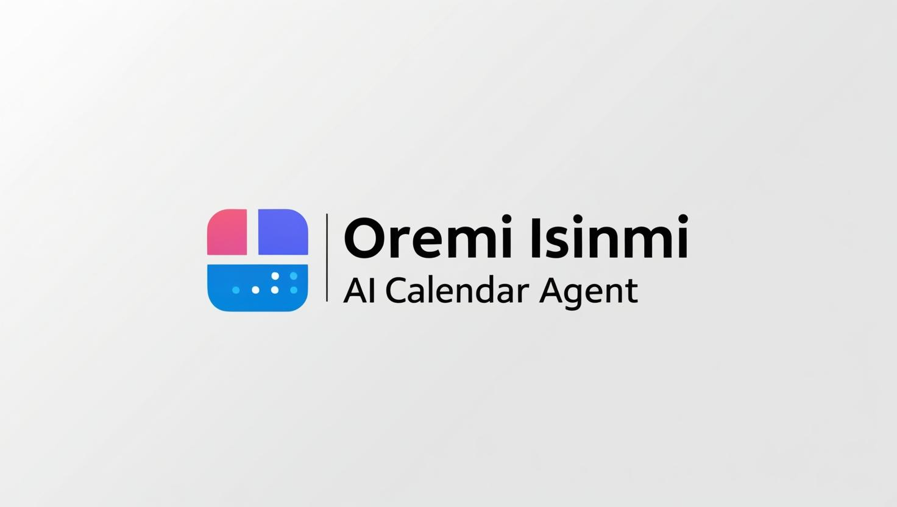

# Oremi Isinmi Agent

**Oremi Isinmi Agent** is a modular time-management agent built designed to
power the Oremi Personal Assistant. It handles alarm scheduling, timers,
reminders, and calendar events using state-of-the-art local language models
(via Ollama) and robust external libraries.

The name **"Oremi Isinmi Agent"** comes from two Yorùbá words: *Oremi*,
meaning "my friend", and *Isinmi*, meaning "rest" or "appointment". Together,
the name conveys the idea of a friendly assistant that helps you manage your
time and commitments efficiently, bringing calm and order to your daily life.

## Documentation

Find the Oremi Isinmi Agent deployment and API documentation at
[https://demsking.gitlab.io/oremi-isinmi-agent](https://demsking.gitlab.io/oremi-isinmi-agent).

## Features

- Alarm scheduling with custom labels and recurrence
- Flexible timers with countdown and cancellation support
- Persistent reminders with optional recurrence
- Calendar event creation and management
- Natural language understanding via Ollama (qwen2.5:3b)
- Built with a focus on performance and security
- Easily deployable using the [`demsking/oremi-isinmi-agent`](https://hub.docker.com/r/demsking/oremi-isinmi-agent)
  Docker image.

## Contribute

Please follow [CONTRIBUTING.md](https://gitlab.com/demsking/oremi-isinmi-agent/blob/main/CONTRIBUTING.md).

## Versioning

Given a version number `MAJOR.MINOR.PATCH`, increment the:

- `MAJOR` version when you make incompatible API changes,
- `MINOR` version when you add functionality in a backwards-compatible manner,
  and
- `PATCH` version when you make backwards-compatible bug fixes.

Additional labels for pre-release and build metadata are available as extensions
to the `MAJOR.MINOR.PATCH` format.

See [SemVer.org](https://semver.org/) for more details.

## License

Licensed under the Apache License, Version 2.0 (the "License"); you may not use
this file except in compliance with the License.
You may obtain a copy of the License at
[LICENSE](https://gitlab.com/demsking/oremi-isinmi-agent/blob/main/LICENSE).
